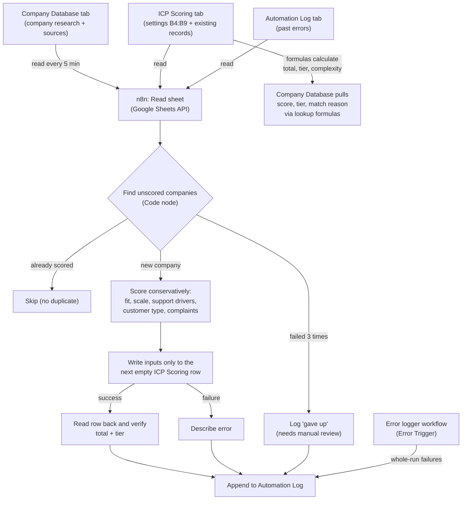

# Global Payments ICP & TAM Research Engine

A GTM Engineering project that researches, scores and qualifies potential customers among global payment companies, both traditional fintech and Web3/crypto payment infrastructure, using Google Sheets as the system of record and n8n for automation.

The engine answers one question for a go-to-market team: **which payment companies are most likely to need a customer-support solution, and why?** Every company gets a 0–100 ICP score, a qualification tier and a written match reason backed by source links. New companies added to the database are scored automatically, and those scores are clearly flagged until a person reviews them.

> **Status:** Portfolio project. The 20-company research dataset, the scoring framework and the n8n automation are built and tested. The scheduled workflow had not yet been published (switched on) at the time of writing. TAM sizing is planned but not yet built (see [Limitations and future improvements](#10-limitations-and-future-improvements)).

---

## Table of contents

1. [Overview](#1-overview)
2. [Problem statement](#2-problem-statement)
3. [Project objectives](#3-project-objectives)
4. [Tools and technologies](#4-tools-and-technologies)
5. [System architecture](#5-system-architecture)
6. [How the ICP scoring framework works](#6-how-the-icp-scoring-framework-works)
7. [Automation workflow](#7-automation-workflow)
8. [Testing and validation](#8-testing-and-validation)
9. [Installation and setup](#9-installation-and-setup)
10. [Limitations and future improvements](#10-limitations-and-future-improvements)
11. [Screenshots](#11-screenshots)
12. [Lessons learned](#12-lessons-learned)

---

## 1. Overview

| | |
|---|---|
| **Target market** | Global payment companies: 10 traditional payment companies and 10 Web3 payment companies |
| **ICP assumption** | The seller offers a product that helps payment companies handle customer support (for example, AI-assisted or automated support). Companies with heavy, complex support workloads are the best fit. |
| **System of record** | Google Sheets (three tabs: `Company Database`, `ICP Scoring`, `Automation Log`) |
| **Automation** | n8n: one scoring workflow and one error-logging workflow |
| **Output per company** | Four sub-scores, a total score (0–100), a qualification tier, a complexity level, a match reason, source URLs, and whether the score is analyst-reviewed or automatic |

### Companies researched

| Traditional payments | Web3 payments |
|---|---|
| Stripe, Adyen, Checkout.com, Paystack, Flutterwave, Wise, Payoneer, Rapyd, dLocal, Airwallex | MoonPay, Circle, BVNK, Ramp Network, Transak, Alchemy Pay, Triple-A, BitPay, Mercuryo, Yellow Card |

### Current qualification results (analyst-reviewed scores)

| Tier | Score range | Companies |
|---|---|---|
| Tier 1 | 80–100 | 7 |
| Tier 2 | 65–79 | 8 |
| Tier 3 | 50–64 | 5 |
| Not qualified | below 50 | 0 |

These results come from the public evidence collected so far. Some companies score lower partly because complaint evidence has not been collected for them yet (see [Limitations](#10-limitations-and-future-improvements)).

---

## 2. Problem statement

Go-to-market teams waste time when they target the wrong accounts. A list of "payment companies" is not a target list: a two-person crypto gateway and a 6,000-person money-transfer company have very different needs, budgets and buying processes.

For a support-focused product, the real buying signal is **support pain**: failed payments, refunds, chargebacks, KYC checks, delayed payouts and account restrictions all create tickets. Companies that serve large numbers of consumers or small businesses feel this pain most.

Without a consistent framework:

- Prioritisation depends on gut feel and brand recognition rather than evidence.
- Research is hard to repeat or audit, because nobody records why an account was chosen.
- New accounts sit unscored until someone has time to research them.

This project turns account research into a **repeatable, evidence-based and partly automated process** in which every score can be traced back to its sources.

---

## 3. Project objectives

1. Build a research database of 20 real global payment companies with verified websites, business models, headquarters, target customers and employee counts. Unknown data is marked as Unknown, and estimates are labelled as estimates.
2. Define a transparent 0–100 ICP scoring framework covering business fit, company scale, support complexity and support workload.
3. Record a match reason and source URLs for every company.
4. Keep the scoring logic in spreadsheet formulas, so changing a threshold updates every score.
5. Automate scoring-record creation for new companies with n8n, including duplicate prevention, conservative handling of missing data, error logging and retries.
6. Clearly separate automatic scores from human-verified scores.

---

## 4. Tools and technologies

| Tool | Used for |
|---|---|
| **Google Sheets** | Company database, scoring model (formulas, dropdowns, checkboxes, conditional formatting), automation log |
| **Google Sheets formulas** | `ARRAYFORMULA`, `VLOOKUP`, `FILTER`, `COUNTIF`, `TEXTJOIN`, so totals, tiers and lookups fill down automatically |
| **n8n** (self-hosted, v2.x) | Scheduled workflow automation |
| **n8n nodes** | Schedule Trigger, Manual Trigger, HTTP Request (Google Sheets API v4 via OAuth2), Code (JavaScript), IF, Error Trigger |
| **Google Sheets API v4** | Reading ranges and writing to exact cell ranges |
| **Public web research** | Company filings, official help centers and developer docs, press releases, workforce trackers, review sites |
| **Claude (AI assistant)** | Research support, building the spreadsheet and workflows, testing |

---

## 5. System architecture

### Spreadsheet structure

**`Company Database`**: one row per company.

| Column | Field | Filled by |
|---|---|---|
| A | Company Name | Research |
| B | Website | Research |
| C | Segment (Traditional / Web3) | Research |
| D | Business Model | Research |
| E | Headquarters | Research |
| F | Target Customer | Research |
| G | Company Size (labelled as fact or estimate, with date) | Research |
| H | Support Complexity (Low / Medium / High) | Formula, from ICP Scoring |
| I | ICP Score | Formula, from ICP Scoring |
| J | Match Reason | Formula, from ICP Scoring |
| K | Source (URLs separated by `\|`) | Research |
| L | Qualification Status | Formula, from ICP Scoring |

**`ICP Scoring`**: the scoring model.

- **Rows 4–9 (settings):** Tier 1 / Tier 2 / Tier 3 minimum scores (80 / 65 / 50), points per support driver (6), and how many drivers count as High (4) or Medium (2) complexity.
- **Row 10:** an automatic check listing any company in the database that has no scoring record yet.
- **Row 11:** headers. **Row 12 onward:** one record per company.

| Columns | Content | Type |
|---|---|---|
| A | Company Name | Input |
| B, C | Business Fit (0–30), Company Scale (0–20) | Input (dropdowns) |
| D–H | Five support-driver checkboxes | Input |
| I, J | Drivers found, Support Complexity (0–30) | Formula |
| K, L | Customer Type (0–10), Complaint Evidence (0–10) | Input (dropdowns) |
| M | Support Workload (0–20) | Formula |
| N | Total ICP Score (0–100) | Formula |
| O | Qualification Status | Formula |
| P | Complexity Level | Formula |
| Q | Match Reason | Input |
| R | Scored By (`Analyst` / `Auto`) | Input |
| S | Review Status (`Reviewed` / `Needs review`) | Input |

**`Automation Log`**: Timestamp (UTC), Company, Event (`created`, `skipped`, `error`, `gave up`), Detail, Target Row, Execution ID.

---

## 6. How the ICP scoring framework works

Every company is scored out of 100 across four components.

| Component | Points | How it is scored |
|---|---|---|
| **Business fit** | 0–30 | 30 = core product moves money for customers (acquiring, payouts, on/off-ramps). 20 = payments is one of several business lines. 10 = adjacent infrastructure. |
| **Company scale** | 0–20 | By employee count: 2,000+ = 20; 500–1,999 = 16; 200–499 = 12; 50–199 = 8; under 50 or Unknown = 4. |
| **Support complexity** | 0–30 | 6 points for each of five support drivers documented in official help pages or docs: (1) failed payments, (2) refunds, (3) disputes, chargebacks or payment exceptions, (4) KYC/KYB or account restrictions, (5) settlement or payout issues. |
| **Support workload** | 0–20 | Customer type (consumer or SMB self-serve = 10, mixed = 6, enterprise only = 3) plus public complaint evidence (strong = 10, some = 5, none found = 0). |

**Qualification status:** Tier 1 at 80+, Tier 2 at 65–79, Tier 3 at 50–64, Not qualified below 50.
**Complexity level:** High with 4–5 drivers, Medium with 2–3, Low with 0–1.

### Design principles

- **Formulas, not typed totals.** Totals, tiers and complexity levels are spreadsheet formulas. Changing a threshold in the settings block updates every company.
- **Evidence over assumption.** Each company has a match reason and source URLs. Employee counts are labelled as *Fact* (filings or company statements) or *Est.* (third-party trackers), with dates.
- **Missing means zero.** A blank or unverified input adds no points. "Unknown" company size scores 4, as the rubric defines it.
- **Human vs automatic.** The 20 researched companies are marked `Scored By = Analyst` and `Review Status = Reviewed`. Any record the automation creates is marked `Auto` and `Needs review` until a person checks it.

---

## 7. Automation workflow

Two n8n workflows keep the scoring table complete as companies are added.

### Workflow 1: `ICP Scoring — Auto-create records`

| Step | Node | What it does |
|---|---|---|
| 1 | **Every 5 minutes** (Schedule Trigger) / **Run manually** (Manual Trigger) | Starts a run. The manual trigger is for testing. |
| 2 | **Read sheet** (HTTP Request) | One Google Sheets API call reads the Company Database, the existing scoring names, the scoring settings and the Automation Log. |
| 3 | **Find unscored companies and score** (Code) | Finds companies that have no scoring record, compared case- and whitespace-insensitively. Skips duplicates and companies that have already failed 3 times. Scores each new company conservatively (rules below). |
| 4 | **Is new record?** (IF) | Sends new records to be written and log-only events (skipped, gave up) straight to the log. |
| 5 | **Write scoring row** (HTTP Request) | Writes **only the input columns** (A–H, K–L, Q–S) to the next empty row, so formula columns are never overwritten. |
| 6 | **Read back row** + **Verify and describe** (HTTP Request + Code) | Re-reads the new row to confirm the spreadsheet calculated a total and tier. |
| 7 | **Describe write error** (Code) | If the write fails, records why. |
| 8 | **Write to Automation Log** (HTTP Request) | Appends a `created`, `skipped`, `error` or `gave up` entry. |

When there are no new companies, step 3 outputs nothing and the run ends there by design.

### Workflow 2: `ICP Scoring — Error logger`

Set as the error workflow for Workflow 1. If a whole run crashes, for example because the sheet can't be read, it writes the failed node and error message to the Automation Log.

### How automatic scores are calculated

The automation uses the same weights and thresholds as the spreadsheet, and reads points per driver live from the settings. It applies stricter, rule-based logic because it has no human judgement:

| Sub-score | Automatic rule | Missing or unverified data |
|---|---|---|
| Business fit | Keywords in Business Model: money-movement terms = 30; payments listed after another business line (issuer, exchange) = 20; adjacent fintech/crypto = 10 | Blank = 0 |
| Company scale | First number in Company Size; for ranges, the **low end** is used | Blank = 0; "Unknown" = 4 |
| Support drivers | Fetches Source URLs on the company's **own domain** and ticks a driver only if the page text mentions it | Unreachable pages and other domains count for nothing |
| Customer type | Keywords in Target Customer (consumer/SMB = 10, mixed = 6, enterprise = 3) | Blank = 0 |
| Complaint evidence | Number of distinct review/complaint sites among the sources (Trustpilot, G2, BBB, Financial Ombudsman and similar): two or more = 10, one = 5 | None = 0 |

Every automatic record includes a match reason listing exactly what was and wasn't found, ending with *"Needs analyst review."*

### Reliability features

- **Duplicate prevention:** names are compared case- and space-insensitively against existing records, and duplicates within the database are only scored once.
- **Error logging:** write failures and whole-run failures are recorded in the Automation Log with the n8n execution ID.
- **Retry handling:** a failed company is retried automatically on the next run. After 3 logged failures it is marked `gave up` and skipped until its error rows are deleted.
- **Formula safety:** the workflow never writes to formula columns.

---

## 8. Testing and validation

| Test | Method | Result |
|---|---|---|
| All 20 companies have scoring records | Cross-checked names in both tabs | Passed |
| Sub-scores add up to totals | Recalculated all 20 totals outside the spreadsheet | Passed (20/20) |
| Tiers match thresholds | Checked every status, including a score of exactly 80 | Passed (score = threshold reaches that tier) |
| Database lookups | Compared score, tier, complexity and match reason across tabs | Passed (20/20) |
| Missing data scores zero | Temporary company with only name, website and segment | Passed: total 0, Not qualified, Auto / Needs review |
| Full scoring path | Temporary company with real official help-page sources | Passed: support drivers detected from official pages |
| Duplicate prevention | Same name entered twice with different capitalisation; workflow run again | Passed: one record only; skip logged once |
| Write failure handling | Write step temporarily pointed at an invalid spreadsheet | Passed: error logged, nothing written |
| Retry limit | Three failures for one company | Passed: logged `gave up`, then skipped |
| Error logger | Manual run with n8n sample error data | Passed: entry written to the log |
| Final end-to-end test | `Test Payment Co` (name, website, segment only) via the manual trigger | Passed: record created, scored 0, status and log correct, no duplicate on re-run |

**Bug found and fixed during testing:** the first automated run scored a company with valid sources at 0 for support drivers and complaints. The n8n Code node sandbox did not support the JavaScript `URL` parser, so every link was silently skipped. It was replaced with a pattern-based parser, and the rerun passed. Because the bug only ever lowered scores, no inflated scores were produced.

**Not yet tested:** the 5-minute schedule itself. Tests used the manual trigger, which runs the same steps; the schedule only runs once the workflow is published.

All temporary test companies, scoring rows and log entries were removed after testing.

---

## 9. Installation and setup

### Prerequisites

- A Google account with Google Sheets
- An n8n instance (self-hosted or n8n Cloud)
- A Google Sheets OAuth2 credential configured in n8n

### Steps

1. **Create the spreadsheet.** Make a Google Sheet with three tabs, `Company Database`, `ICP Scoring` and `Automation Log`, using the column layout in [System architecture](#5-system-architecture). (Optional: add a sanitized copy or template link here: `<!-- TEMPLATE LINK -->`.)
2. **Add the scoring settings** to `ICP Scoring!B4:B9`: `80, 65, 50, 6, 4, 2`.
3. **Add the formulas.** Put the array formulas in `ICP Scoring` row 12 (columns I, J, M, N, O, P) and the lookup formulas in `Company Database` row 2 (columns H, I, J, L). Leave the cells below them empty so they fill down.
4. **Connect Google Sheets in n8n.** Create a Google Sheets OAuth2 credential, signed in with the account that owns the sheet.
5. **Import the workflows.** In n8n, import `workflows/icp-scoring-auto-create.json` and `workflows/icp-scoring-error-logger.json`.
   - Replace `YOUR_SPREADSHEET_ID` in every HTTP Request URL with your sheet's ID.
   - Select your Google Sheets credential on each HTTP Request node.
   - In the scoring workflow's settings, set the error workflow to **ICP Scoring — Error logger**.
6. **Test first.** Add a test company, run the scoring workflow with **Run manually (testing)**, check the new row and the Automation Log, then delete the test data.
7. **Publish** the scoring workflow to switch on the 5-minute schedule.

> **Security:** never commit credentials, OAuth tokens, API keys, spreadsheet IDs from your own account, or n8n instance URLs. Workflow exports reference credentials by ID only, but replace the spreadsheet ID with a placeholder before committing.

---

## 10. Limitations and future improvements

### Current limitations

- **TAM not yet calculated.** Despite the project name, this version covers ICP research and scoring only. Market sizing is the next phase.
- **Automatic scores are rough.** Keyword matching can over-count drivers. In one test it found all 5 drivers on pages where manual review had confirmed 4. That is why every automatic record is flagged for review.
- **Employee counts are mixed quality.** Public companies use filings; private companies rely on third-party estimates that can disagree. The automation uses the low end of a range.
- **Complaint evidence is incomplete.** It has not been collected for every company, so some (mostly enterprise-focused) companies may be under-scored.
- **Exact name matching.** Scores link to the database by company name, so names must match exactly. "Ramp" will not match "Ramp Network".
- **Availability.** A self-hosted n8n instance only runs while it is online. Missed companies are picked up on the next run.
- **Official-domain rule.** Help centers hosted on a different domain (for example a third-party help-desk platform) are not scanned automatically.

### Future improvements

- Build the **TAM layer**: market sizing per segment and region from the qualified accounts.
- Use an **LLM-assisted driver check** that reads help pages and returns the supporting quote, replacing keyword matching.
- **Enrichment** from a firmographic data provider for employee counts and funding data.
- **Contact discovery and CRM sync** for Tier 1 accounts.
- A **unique company ID** instead of name matching.
- A **dashboard** of tier distribution, segment comparisons and review backlog.

---

## 11. Screenshots

> Replace each placeholder with a screenshot. Blur or crop anything that shows your email, spreadsheet URL/ID, n8n instance URL or credential names.

### 11.1 Company Database
<!-- Full view of the Company Database tab showing the 20 companies, scores and tiers -->

### 11.2 ICP Scoring model
<!-- Settings block (rows 1–10) plus the scoring table with sub-scores, totals and tiers -->

### 11.3 n8n scoring workflow
<!-- Full canvas of "ICP Scoring — Auto-create records" -->

### 11.4 Successful automated run
<!-- Canvas after a run that created a record: every node green with item counts -->

### 11.5 Automatically created record
<!-- The new ICP Scoring row showing Auto / Needs review, plus the matching Company Database row -->

### 11.6 Automation Log
<!-- Log entries showing created / skipped / error events -->

### 11.7 Error handling
<!-- Log showing an error followed by "gave up", or the error logger workflow after a run -->

---

## 12. Lessons learned

- **Define the ICP before collecting data.** The scoring framework decided what research mattered: support drivers and workload, not just company size.
- **Separate facts from estimates early.** Labelling each employee count as fact or estimate, with a date, made the data easier to trust and to defend.
- **Keep logic in one place.** Putting totals and tiers in formulas, and having the automation write only inputs, meant there was one source of truth and nothing to keep in sync.
- **Automation should be more conservative than a human.** Rules can't judge context, so automatic scores give zero for anything unverified and are always flagged for review.
- **Test the failure paths, not just the happy path.** Deliberately breaking the write step proved that logging and the retry limit worked. Testing with real sources caught a sandbox bug that a synthetic test would have missed.
- **Design for idempotency.** Because the workflow scans for unscored companies rather than reacting to one-off events, running it again is always safe and missed runs catch up on their own.

---

*This is a portfolio project. Company information comes from public sources and was accurate to the best of the author's research at the time of writing. Scores reflect fit for a hypothetical support-focused product and are not an assessment of any company's quality.*
